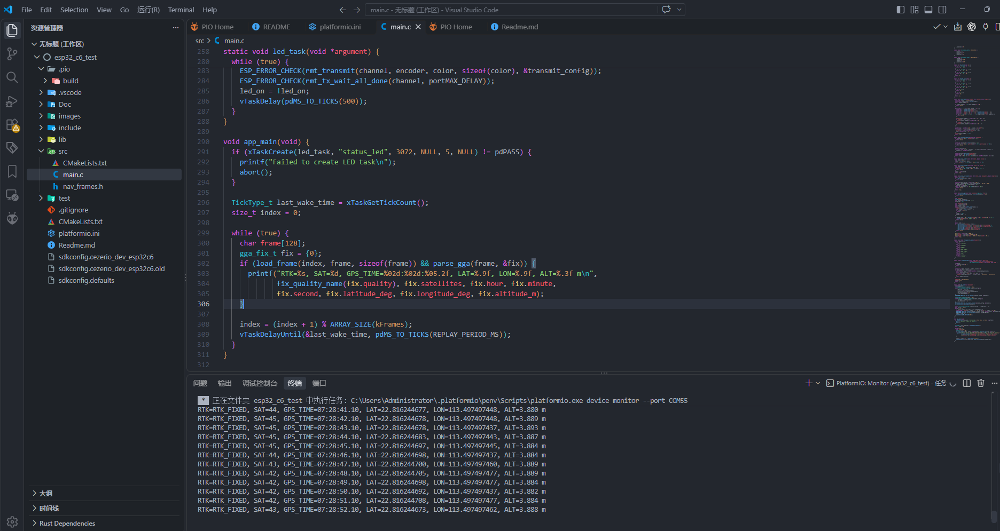

# 接入 ESP32

:::{admonition} 本页目标
:class: page-summary

将 **D20** 通过 UART 接入 ESP32。ESP32 只需接收并解析标准 NMEA 数据，即可获得 RTK 定位状态、卫星数、经纬度、高程、速度和航向等信息。
:::

## 接线

接线前保持 D20 和 ESP32 断电。D20 使用 **5 V ±0.5 V 供电**，UART 为 **3.3 V 电平**；ESP32 的具体 UART GPIO 应以所用开发板的引脚定义为准。

| D20 | ESP32 | 说明 |
| --- | --- | --- |
| Pin 4 TX | UART RX GPIO | D20 数据输出 |
| Pin 5 RX | UART TX GPIO | 需要向 D20 发送配置时连接 |
| Pin 1 GND | GND | 必须共地 |
| Pin 6 5 V | 稳定的 5 V 电源 | 不得接 ESP32 的 3.3 V 引脚 |

完整 Pin 定义见 [D20 接口与接线](../operation/d20-wiring.md)。不要按线束颜色判断信号，也不要向 D20 的 TX、RX 或 PPS 接入 5 V。

## D20 输出设置

ESP32 直接解析文本时，建议让 D20 输出 NMEA，并至少开启：

- `GGA`：定位质量、卫星数、经纬度和高程。
- `RMC`：UTC 日期时间、速度和航向。

D20 默认串口为 **115200 bps、8N1、无流控**。若设备当前输出 UBX，可按[配置输出消息](../maintenance/parameters.md)启用 NMEA，或参考[固件与输出协议选择](../operation/firmware-output.md)选择合适固件。

## ESP32 端处理

ESP32 端需要完成以下处理：

1. 选择一个硬件 UART，并根据开发板原理图配置对应的 RX/TX GPIO。
2. 将串口设置为 **115200 bps、8N1、无流控**。
3. 按行接收以 `$` 开头、以换行结束的 NMEA 语句，并校验语句校验和。
4. 解析 `GGA` 获取定位质量、卫星数、经纬度和高程；解析 `RMC` 获取 UTC 时间、速度和航向。
5. 根据 `GGA` 的定位质量字段判断当前为无定位、普通定位、RTK 浮点解或 RTK 固定解。

可以使用现有 NMEA 解析组件，也可以按 NMEA 0183 格式自行解析。

:::{admonition} 接入完成判据
:class: success-check

ESP32 能持续接收并解析 D20 的 NMEA 数据；在开阔环境且差分链路正常时，可解析到 RTK 固定解，经纬度、卫星数和高程持续更新。
:::

若没有数据，优先检查 TX/RX 是否交叉、GND 是否共地、GPIO 配置是否正确，以及 D20 与 ESP32 是否都使用 115200 bps。若有定位数据但无法固定，按[RTK 状态与固定解验证](../operation/rtk-fixed-validation.md)检查差分链路和卫星环境。
